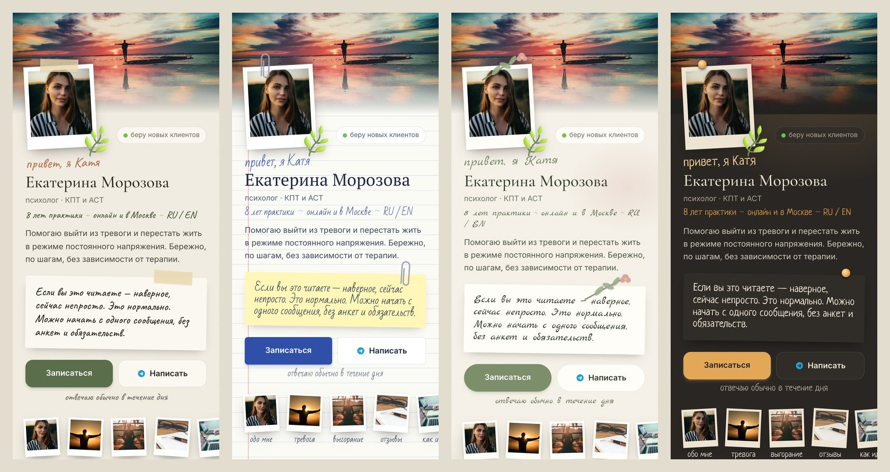
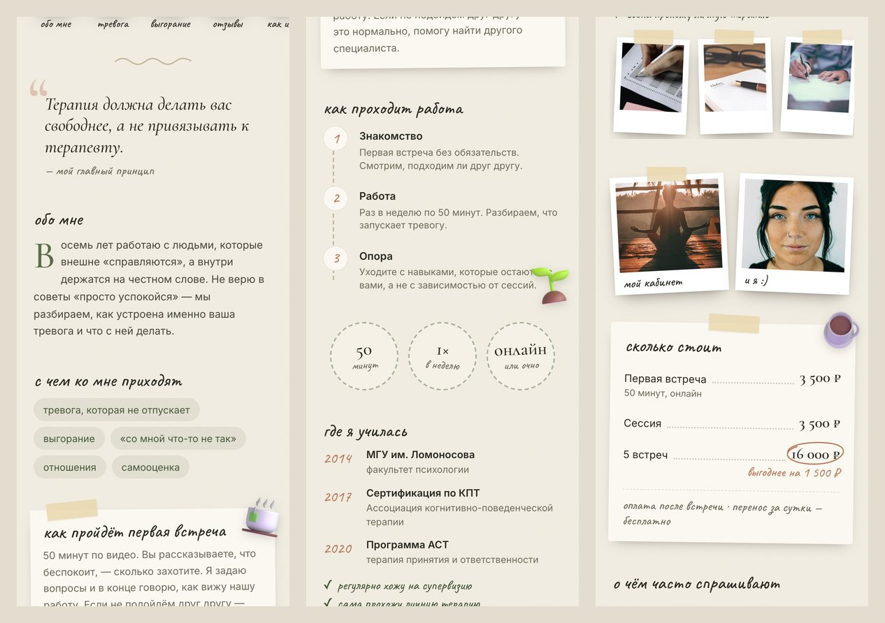
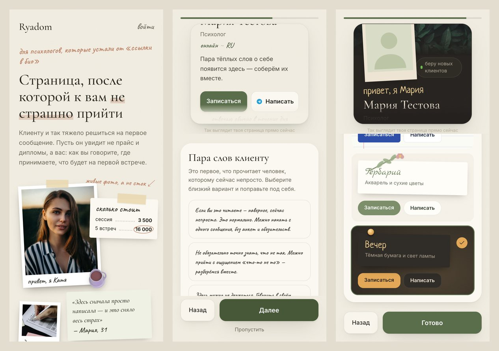
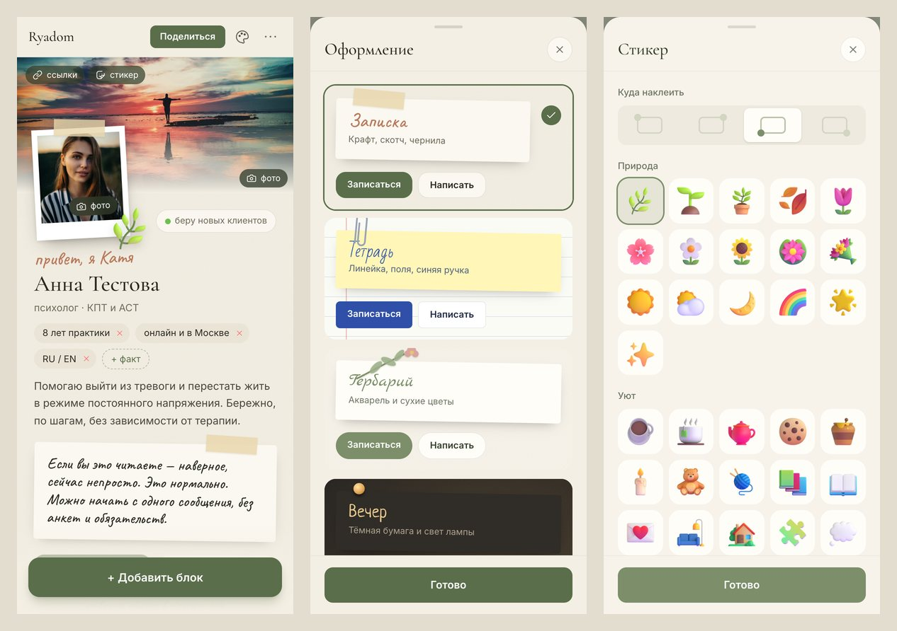

# Ryadom

**Одна тёплая страница вместо визитки, сайта и хаотичного Instagram.**

Ryadom («рядом») — конструктор личной страницы для психологов и помогающих специалистов.

Идея простая. Специалисту негде по-человечески рассказать о себе: Instagram шумный и не
про это, свой сайт — долго, дорого и потом некому обновлять, а «ссылка в био» из десяти
кнопок выглядит холодно. Хотелось дать одну живую страницу — собрал за пару минут, скинул
клиенту короткую ссылку `ryadom.app/имя`, и всё.

Название — про суть самой работы. *Рядом.* Не «сервис» и не «платформа», а ощущение: тебя
видят, ты не один. Поэтому и страница не анкета, а что-то живое: шапка, «актуальное» как
сторис, лента блоков про себя, подход и услуги, и заметная кнопка «записаться».

## 🚧 Статус

В активной разработке. Пет-проект и портфолио-работа — веду его, чтобы довести идею до
живого продукта и заодно показать, как думаю про архитектуру и продуктовые мелочи.
Пример готовой страницы — `/demo`.



## Концепция: записка, а не анкета

Страница психолога — это первое, что видит человек, которому сейчас непросто. Поэтому она
должна ощущаться как записка от живого человека, а не как визитка из конструктора: полароид
на скотче вместо круглого аватара, пометки от руки («привет, я Катя», «отвечаю обычно в
течение дня»), записка «пара слов от меня», цены как меню в кофейне, отзывы как записки,
финал — как конверт с подписью.



## Как это работает

Три шага для специалиста:

1. Отвечает на вопросы онбординга, как в разговоре: с чем приходят, как проходит первая
   встреча, сколько стоит. Для «пары слов» и вопросов клиентов есть готовые тёплые
   варианты — их правят, а не пишут с нуля. Из ответов сразу собирается страница.
2. Правит прямо на странице или в коротком листе. Наклон записок, скотч, почерк и
   расположение фото система выставляет сама — сделать некрасиво нельзя.
3. Делится ссылкой `/<handle>` — с красивым превью, когда её кидают в мессенджер. Кнопки
   «Записаться» и «Написать» ведут туда, куда он укажет: в Telegram, на сайт записи, в почту.

Разделы: пара слов, с чем приходят, первая встреча, обо мне, принцип, как проходит
работа, факты-штампы, образование (годы, дипломы, супервизия), фото, цены, вопросы,
отзывы, финал. Плюс «актуальное» маленькими полароидами.



## Темы: другой материал, а не другой цвет

- **Записка** — крафтовая бумага, скотч, чернила (Caveat).
- **Тетрадь** — линейка с красным полем, синяя ручка (Bad Script), скрепки.
- **Гербарий** — акварельные пятна, засушенные веточки, каллиграфия (Marck Script).
- **Вечер** — тёмная бумага, свет лампы, булавки, светлые чернила (Neucha).

Тема — это набор CSS-переменных в `[data-theme]`: цвета, шрифты, фактура бумаги, форма
кнопок. Все классы Tailwind построены на этих переменных, поэтому блоки о темах не знают.
Единственное, что различается по разметке, — крепление (`components/paper.tsx`): блок
ставит `<Fix/>`, а тема решает, скотч это, скрепка, веточка или булавка.

Своё лицо странице дают фото, тексты и **стикеры** — 45 объёмных наклеек (чашка, плед,
ёжик, росток…) в углу шапки или любого раздела. В профиле хранится только id из
закрытого списка.



## Стек

Next.js 15 (App Router) · React 19 · TypeScript · Tailwind 4 · Supabase (Postgres + Storage) · zod · Vitest

## Как устроено внутри

- Профиль лежит целиком одним `jsonb`-объектом — можно свободно менять форму данных без миграций, пока продукт ищет себя.
- Каждый блок — размеченное объединение по полю `type` (`lib/types.ts`): добавить новый блок = вариант в тип + компонент, остальное ловит компилятор.
- Service-role ключ Supabase живёт только на сервере и в браузер не попадает; RLS включён.
- Сессии свои, на подписанной HMAC-cookie, без внешних auth-библиотек — хотелось разобраться, как это работает под капотом.
  Срок жизни зашит в подписанную часть, так что старую cookie нельзя «продлить». Пароли — scrypt
  из `node:crypto` с солью; на неверный пароль и несуществующий email ответ одинаковый.
- Профиль приходит с клиента, поэтому сервер ему не верит: перед сохранением и перед показом
  он проходит через zod-схему (`lib/profileSchema.ts`). Лишние поля отбрасываются, длины
  ограничены, в ссылках разрешены только `https:`, `tg:`, `mailto:`, `tel:`. Схема и
  TypeScript-типы проверяют друг друга на этапе компиляции — разъехаться им не дадут.
- Фото проверяются по первым байтам файла, а не по заголовку от браузера, — SVG и HTML под
  видом картинки не пройдут.

## Запуск

```bash
npm install
cp .env.example .env           # ключи Supabase + SESSION_SECRET
# Supabase → SQL Editor: выполнить supabase/schema.sql (таблица и bucket для фото)
npm run seed:demo              # необязательно: пример страницы на /demo
npm run dev                    # http://localhost:3000
```

Для базы, созданной по старой схеме, — `supabase/migrations/002_password_auth.sql`.

## Тесты

```bash
npm test            # Vitest
npm run lint && npm run typecheck
```

Тесты закрывают серверную часть: сессии (подделка, продление, истёкший срок), пароли,
zod-схему профиля (профиль из онбординга, каждый блок из меню, опасные ссылки и картинки,
лишние поля), проверку типа файла и сами API-маршруты регистрации, входа и сохранения
профиля с подменённой базой. В CI ещё линтер, проверка типов и сборка.

## Структура

```
app/                 маршруты: edit/, [handle]/, api/
components/          blocks/ (рендер блоков), editor/, onboarding/
lib/                 данные (Supabase), типы, zod-схема, сессии, пароли
supabase/            схема БД, миграции, демо-профиль
tests/               Vitest
prototype/           первый vanilla-JS прототип — с него всё начиналось
```

## Благодарности

Стикеры — [Fluent Emoji](https://github.com/microsoft/fluentui-emoji) от Microsoft, лицензия MIT
(`public/stickers/LICENSE`). Шрифты Caveat, Bad Script, Marck Script, Neucha, PT Serif, Cormorant Garamond — Google Fonts, лицензия OFL.
